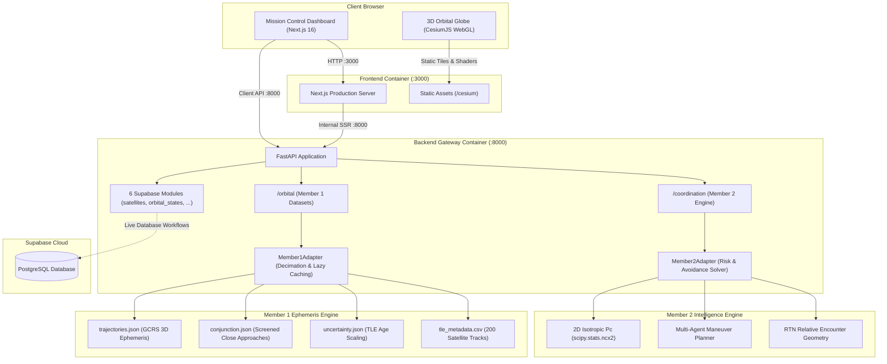

# ORBI-SYNC: Cooperative Satellite Collision Avoidance System


**Deployement link-** https://frontend-six-pearl-75.vercel.app


> **ORBI-SYNC** is an autonomous space traffic management and collision avoidance intelligence ecosystem uniting orbital ephemeris propagation, encounter-plane collision risk evaluation, multi-agent maneuver planning, and mission control visualization into a production-ready platform.

[](https://python.org)
[](https://fastapi.tiangolo.com)
[](https://nextjs.org)
[](https://cesium.com)
[](https://www.docker.com/)

---

## 1. System Architecture



---

## 2. Integrated Codebases & Data Contracts

| Component | Directory | Technology | Role |
| :--- | :--- | :--- | :--- |
| **Central Backend** | `MEMBER 4/` | FastAPI, Pydantic, Uvicorn | CORS API gateway, role-based security, modular routers, Supabase PostgreSQL interface. |
| **Intelligence Engine** | `member2/` | Python, SciPy, NumPy | Encounter-plane collision probability ($P_c$), multi-agent burn planning, RTN encounter geometry. |
| **Orbital Engine** | `member 1/ORBI-SYNC/` | SGP4, GCRS, CSV/JSON | High-precision orbital propagation, 200-satellite catalogue, 40 screened close approaches. |
| **Mission Control** | `frontend/` | Next.js 16, React 19, CesiumJS | Interactive 3D orbital globe, real-time telemetry, situation overview, conjunction alerts. |

---

## 3. Quickstart: Production Deployment via Docker Compose

### Prerequisites
* [Docker Desktop](https://www.docker.com/products/docker-desktop/) (Docker 24+ & Docker Compose v2)

### One-Command Launch
```bash
# 1. Clone repository
git clone https://github.com/your-org/ORBI-SYNC.git
cd ORBI-SYNC

# 2. Configure environment (optional, defaults provided)
cp .env.example .env

# 3. Build and start containers
docker compose up -d --build
```

### Accessing the Platform
* **Mission Control Web App:** [http://localhost:3000](http://localhost:3000)
* **Interactive API Documentation (Swagger):** [http://localhost:8000/docs](http://localhost:8000/docs)
* **API Healthcheck:** [http://localhost:8000/health](http://localhost:8000/health)

---

## 4. Local Development Startup

### 1. Central Backend (FastAPI Gateway)
```powershell
cd "MEMBER 4"
python -m venv .venv
.\.venv\Scripts\Activate.ps1
pip install -r requirements.txt
python -m uvicorn app.main:app --host 127.0.0.1 --port 8000 --reload
```

### 2. Next.js 16 Mission Control Frontend
```powershell
cd "frontend"
pnpm install
pnpm run build
pnpm run start -p 3000
# Or for live hot-reload development:
pnpm run dev
```

---

## 5. Production API Connectivity & Endpoints

### Core Health & Subsystem Status
* `GET /health`: Instant container readiness probe (`{"status": "ok"}`).
* `GET /coordination/status`: Reports integration status across Member 1, Member 2, and Member 4.
* `GET /orbital/metadata`: Dataset freshness, SGP4 GCRS epoch, and TLE cryptographic SHA-256 hash.

### Orbital Satellites & Trajectories
* `GET /orbital/satellites?limit=50&offset=0`: 200-satellite catalog with TLE lines, age, and uncertainty scales.
* `GET /orbital/trajectories?step=15&limit=20`: Adaptive decimation engine reducing 4,321 propagation steps to 289 points per orbit (~96% network payload reduction).

### Close Approach Screening & Risk Intelligence
* `GET /orbital/conjunctions`: Raw screening results (40 close approaches detected via continuous-run minimization).
* `GET /orbital/enriched-conjunctions?limit=40`: Conjunctions evaluated with Member 2 collision probabilities ($P_c$) and candidate maneuver plans.
* `GET /coordination/conjunctions`: Unified conjunction catalogue merging Member 1 screened approaches with baseline scenarios.

---

## 6. System Verification & Test Suite

Verify all integrated services with the automated production connectivity script:
```bash
python scripts/verify-production.py http://localhost:8000 http://localhost:3000
```

### Running Backend Unit & Integration Tests
```powershell
# Member 4 API & Module Tests (125 tests)
python -m pytest "MEMBER 4/tests"

# Member 2 Intelligence Engine Tests (20 tests)
$env:PYTHONPATH = "member2"
python -m pytest "member2/tests"
```

### Running Frontend Production Build Check
```powershell
cd frontend
pnpm run build
```

---

## 7. Safety, Compliance & Synthetic Disclosures
- **Zero Live DB Mutations:** Tests and demonstration modes run safely with `ALLOW_LIVE_WRITE_TESTS=false` to protect remote Supabase PostgreSQL databases from unintended writes.
- **Mandatory Synthetic Labeling:** In accordance with space flight certification requirements, maneuver impulse ($\Delta v$) evaluations remain labeled with `isSynthetic: true` and `(synth)` warnings until Member 1's numerical repropagation callback is linked.
